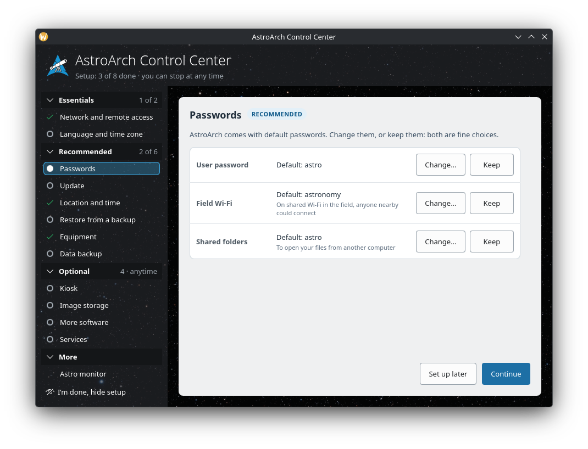
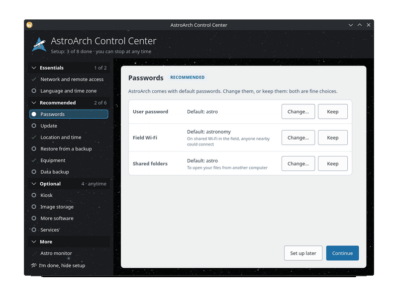
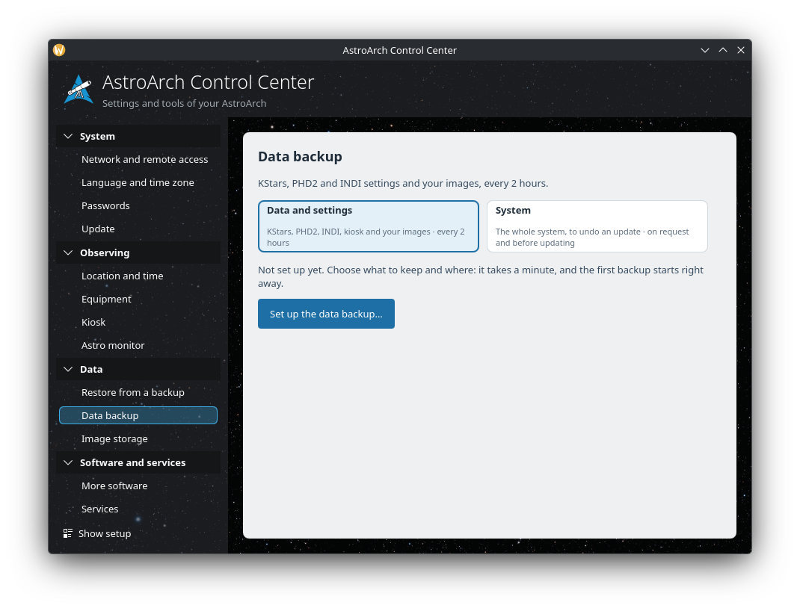
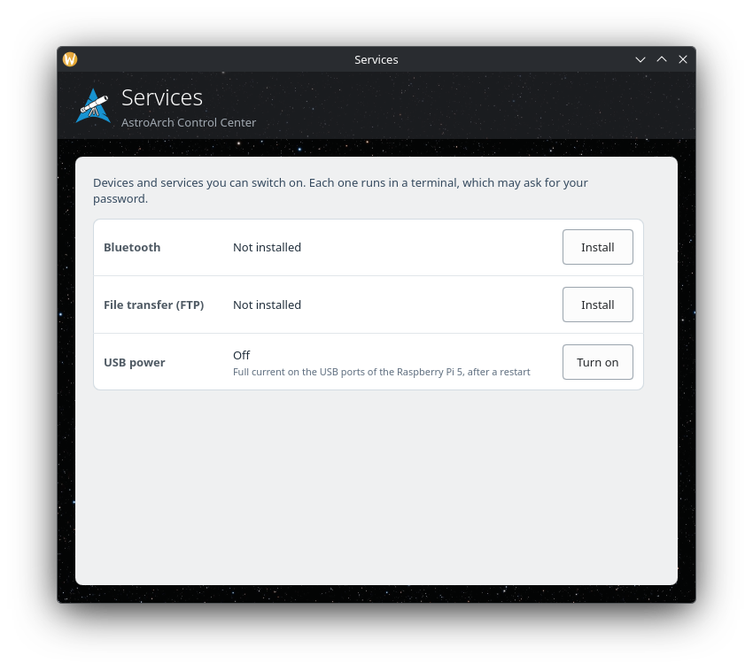
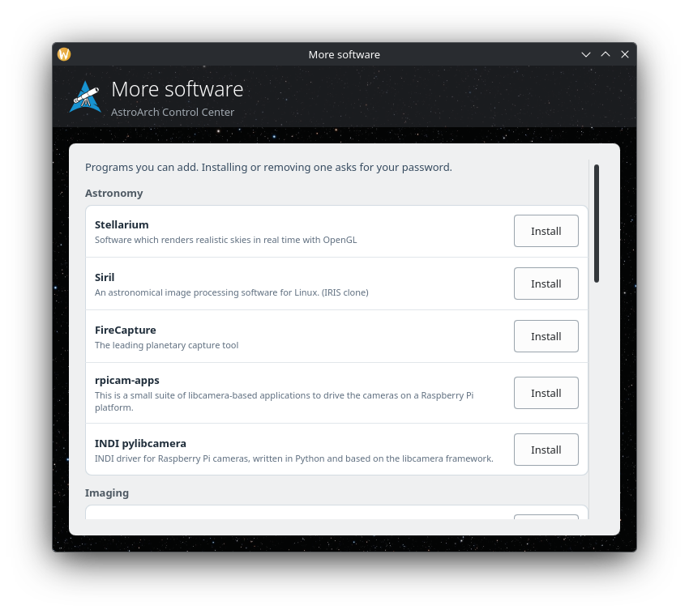
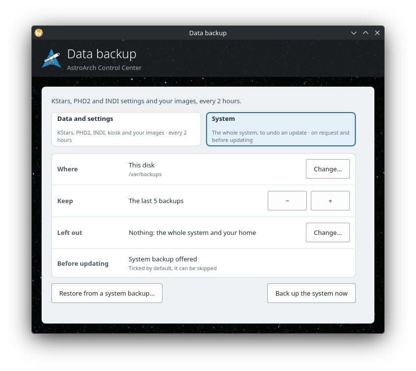
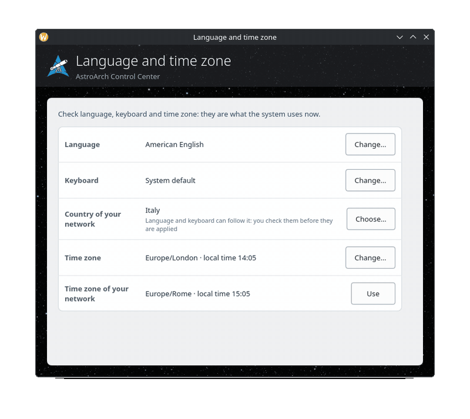
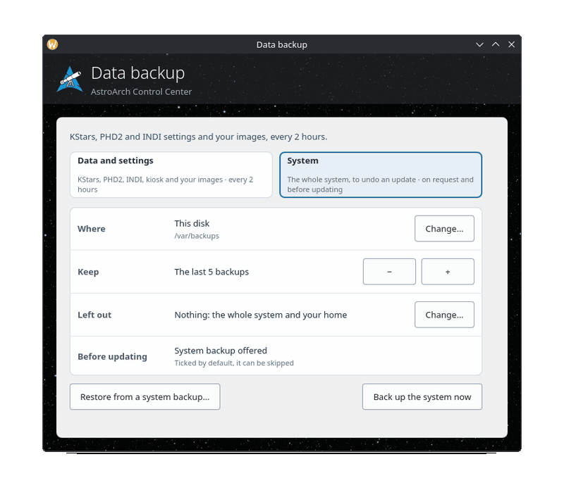

# astroarch-tools

Configuration tools for [AstroArch](https://github.com/devDucks/astroarch), the Arch Linux
ARM based distribution for astrophotography on the Raspberry Pi.

Everything a user sets up or changes on AstroArch without a terminal: network, language,
passwords, updates, backups and restores, the kiosk desktop, image storage, extra software
and services. Every tool is **written in Rust with a QML interface** (cxx-qt 0.10, Qt 6,
Kirigami/Breeze, no C++), with small shell helpers for what runs as root, built with Cargo
alone, and translated in English, French, German, Italian and Spanish.

## The Control Center: one window, two ways

The **AstroArch Control Center** (`crates/astroarch-control-center`) gathers all of the
tools in one window. Each page shows the current values read from the system, one per row,
with the buttons that change them. It is used in two ways.

### On a new AstroArch: the setup

On a new AstroArch the Control Center guides the setup (started at login with
`--autostart`, it opens only while the setup is shown). The pages are grouped as
Essentials, Recommended, Optional and More, each with a status (to do, done, set up later,
not needed). Nothing is mandatory: "Set up later" (or "I don’t need this" on optional
pages) moves on, and the user can stop at any time. A page whose state can be read
(network, location, equipment, data backup) is done as soon as the system says so.

A tour of the setup pages (animated)

### Afterwards: the settings and tools of AstroArch

"I’m done, hide setup" keeps every page, grouped by topic instead (System, Observing,
Data, Software and services, Connection). The Control Center is then where AstroArch is
configured, from its menu entry.

### Separate apps: one page in its own window

The menu entries of the single tools (Services, More software, Data backup, Language and
time zone) open the Control Center on that page alone
(`astroarch-control-center --page ID --single`): a smaller window, with the page's own
name and icon in the task manager. A task always looks the same, wherever it is started.

| Services | More software | Data backup |
|---|---|---|
|  |  |  |

Pages with several steps are wizards inside the page, as the language one:
country → language → keyboard (with a field to try the layout), nothing applied before the
last step.

A system backup can also bring the whole system back, to undo an update: Data backup →
System → "Restore from a system backup…", then "Restore the whole system…" on a snapshot,
with a safety backup first.

## What is in this repository

| Crate | What it is |
|---|---|
| [`astroarch-control-center`](crates/astroarch-control-center) | The Control Center: the setup and the settings in one window, the pages Network and remote access, Language and time zone, Passwords, Update, Location and time, Equipment, Data backup, Restore from a backup, Kiosk, Image storage, More software, Services, Astro monitor, How to connect. Pages are data (`qml/Main.qml`); the system is read by a probe script; root actions go through small helpers and polkit |
| [`astroarch-backup`](crates/astroarch-backup) | Two backup profiles. **System**: the whole system in a preallocated Btrfs image with read-only snapshots, offered before updates, and the full system restore. **Data and settings**: KStars, PHD2, INDI, the kiosk and the images, every 2 hours, as rsync snapshots on a USB drive, a network folder, this disk or Syncthing |
| [`astroarch-locale-module`](crates/astroarch-locale-module) | Country, language, keyboard layout and variant (`locale-gen`, `localectl`, the Plasma session layout) |
| [`astroarch-software-installer`](crates/astroarch-software-installer) | Extra astronomy software, from a TOML list, installed or removed with pacman |
| `astroarch-sys-manager` | Services: Bluetooth, file transfer (FTP), USB power (and gpsd in its own window) |
| `astroarch-build` | The shared `build.rs` code (QML modules, translations) |

The Control Center does not copy the other tools: its pages compile in their code (symbolic
links and `#[path]` modules), so a fix in a tool is a fix in its page. Each tool still
builds its own standalone binary. The crates with a README there give the details.

The kiosk desktop itself and the image build live in
[devDucks/astroarch](https://github.com/devDucks/astroarch).

## Build

On Arch Linux (ARM or x86):

    sudo pacman -S --needed base-devel rust qt6-base qt6-declarative qt6-tools kirigami qqc2-desktop-style polkit
    cargo build --release
    cargo test

Then, for example:

    target/release/astroarch-control-center                       # the whole window
    target/release/astroarch-control-center --page backup --single  # one page alone

A development build finds the other tools and the helper scripts next to it; without their
polkit policies installed, pkexec asks for an administrator password for each action. What
an installed system needs (helpers, policies, timers) is listed in each crate's README.

Translations: `qsTr()` in the QML, `.ts` files compiled by `build.rs` with `lrelease`
(from `qt6-tools`); without it the interface stays in English.

## Credits

The backup tool, the locale module, the software installer and the services manager were
written by [sc74](https://github.com/sc74); the Control Center brings them in one window.

License: MIT (`LICENSE`), except `astroarch-software-installer`, GPL-3.0-or-later (its
`Cargo.toml`).
